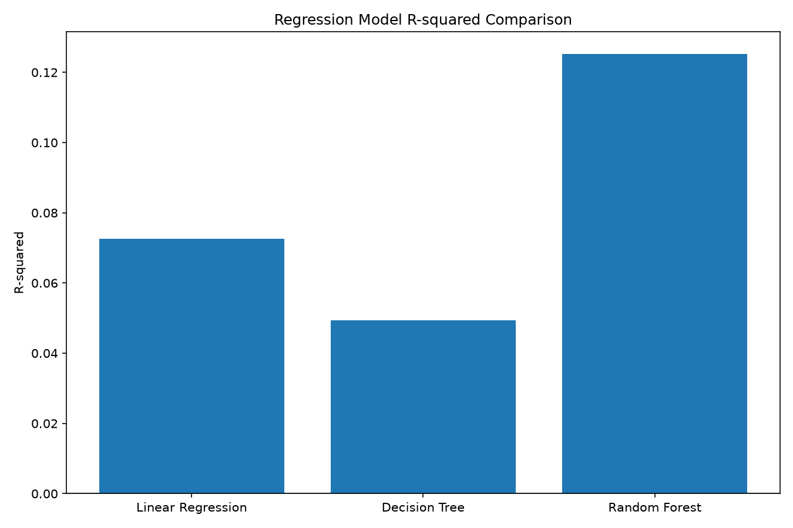


# CMSC 170 — Final Project

University of the Philippines Los Baños  

CMSC 170: Introduction to Artificial Intelligence

## Project Overview

This project implements and compares three regression methods from scratch using the DPWH Infrastructure Transparency Dataset. The models estimate recorded infrastructure project budgets from project characteristics.

## Dataset

- **Name:** DPWH Infrastructure Transparency Dataset
- **Source:** https://data.bettergov.ph/
- **Records:** 248,220
- **Fields:** 23
- **Original Format:** Parquet
- **Working Format:** CSV (converted from Parquet)

### Final features

The selected comparison uses 152 features: category (6), region (18), infrastructure year (1), project description (10), detailed DPWH administrative location (101), and source of funds (16). The target is the recorded project budget in PHP. See [shared preprocessing](docs/PREPROCESSING.md) for the feature definitions and split protocol.

## Methods

The group implemented and evaluated three regression methods:

1. **Linear Regression** — Predicts budgets using learned numerical relationships between project characteristics.
2. **Decision Tree Regression** — Predicts budgets using learned decision rules.
3. **Random Forest Regression** — Combines predictions from multiple decision trees.

All three methods use the same preprocessing, held-out test projects, and evaluation metrics.

## Project Structure

The repository contains the model implementations, validation script, saved results, and project page.

```text
cmsc-170-ai-project/
├── data/
│   ├── DATA_PLAN.md
│   └── README.md
├── docs/
│   ├── assets/
│   │   ├── error_comparison.png
│   │   ├── model_comparison.csv
│   │   ├── r2_comparison.png
│   │   └── site.css
│   ├── index.html
│   └── PREPROCESSING.md
├── experiments/
│   └── description_validation.py
├── results/
│   ├── error_comparison.png
│   ├── model_comparison.csv
│   └── r2_comparison.png
├── src/
│   ├── models/
│   │   ├── decision_tree.py
│   │   ├── linear_regression.py
│   │   └── random_forest.py
│   ├── comparison.py
│   ├── data_loader.py
│   ├── description_features.py
│   ├── evaluation.py
│   ├── funding_features.py
│   ├── location_features.py
│   └── preprocessing.py
├── tests/
│   └── test_evaluation.py
├── CONTRIBUTIONS.md
├── README.md
└── .gitignore
```

### Directory Descriptions

| Path | Purpose |
|---|---|
| `data/` | Dataset documentation, sources, and data preparation plan |
| `src/models/` | From-scratch implementations of the three regression methods |
| `src/data_loader.py` | Loading and reading dataset records |
| `src/preprocessing.py` | Data cleaning, feature encoding, and dataset splitting |
| `src/evaluation.py` | Shared regression metrics |
| `src/comparison.py` | Final held-out comparison and graph generation |
| `experiments/` | Feature validation script |
| `tests/` | Shared evaluation tests |
| `results/` | Experimental results, comparison tables, and visualizations |
| `docs/` | GitHub Pages project website |
| `CONTRIBUTIONS.md` | Group responsibilities and contribution log |
| `.gitignore` | Excludes local datasets and unnecessary files from Git tracking |

**Note:** Dataset files are excluded from Git tracking. The original dataset can be obtained from the source linked above.

## Implementation

The group implemented all three methods from scratch. The project uses:

- Python standard library
- NumPy (arrays and basic linear algebra only)
- Matplotlib (plots and visualizations)

The implementations use no prebuilt machine learning algorithms.

## Development Workflow

The project follows a collaborative Git workflow:

1. The `main` branch contains the integrated project.
2. Members work on separate feature branches for their assigned tasks.
3. Changes are reviewed and integrated through pull requests.
4. All implementations follow the agreed data format and experimental setup.
5. Contributions and milestone progress are documented throughout development.

### Group Responsibilities

| Member | Primary Responsibility |
|---|---|
| Sean Castillo | Repository management, data preparation, Linear Regression, shared evaluation, model comparison, integration, and documentation |
| Donna Cadayona | Decision Tree Regression implementation and evaluation |
| Justin Lawrence Cruz | Random Forest Regression implementation and evaluation |

See [the contribution log](CONTRIBUTIONS.md) for details.

## Project Milestones

| Milestone | Schedule | Deliverable |
|---|---|---|
| 1 — Proposal | October 19–23, 2026 | Dataset and methods approval |
| 2 — Working Program | November 2–6, 2026 | Working implementations of all methods |
| 3 — Comparison | November 9–13, 2026 | Evaluation workflow and comparison results |
| 4 — Project Page | November 16–20, 2026 | GitHub Pages project website |
| 5 — Presentation | November 23–27, 2026 | Final group presentation |


## Reproducibility

### Requirements

- Python 3.12
- NumPy
- Matplotlib

Install the required libraries:

```powershell
python -m pip install numpy matplotlib
```

The regression algorithms were implemented from scratch. NumPy is used for numerical operations, while Matplotlib is used to generate graphs.

### Dataset Setup

The project uses the DPWH Infrastructure Transparency Dataset.

The original dataset is available at:
https://huggingface.co/datasets/bettergovph/dpwh-transparency-data

The program expects the prepared CSV file at:

`data/dpwh_transparency_data.csv`

The CSV must contain the original fields used during preprocessing, including `category`, `infraYear`, `location`, and `budget`.

The dataset is excluded from Git because of its file size. See `data/README.md` for additional dataset information.

### Data Preparation

The original seed-67 split of 241,155 valid records reserves 48,231 projects for final testing and uses 192,924 projects for training. Feature and setting selection used overlapping validation splits (seeds 68, 69, and 70) within the training partition. The final comparison uses all 152 features and learns feature vocabularies and year scaling from training data only.

### Running the Models

Run the following commands from the repository's root directory.

Linear Regression:

```powershell
python -m src.models.linear_regression
```

Decision Tree Regression:

```powershell
python -m src.models.decision_tree
```

Random Forest Regression:

```powershell
python -m src.models.random_forest
```

The individual scripts are model entry points. To reproduce the reported 152-feature final test comparison, use the unified script:

```powershell
python -m src.comparison
```

### Model Settings

| Model | Settings |
|---|---|
| Linear Regression | Learning rate: 0.05; iterations: 200 |
| Decision Tree | Maximum depth: 16; minimum split: 20; minimum leaf: 10 |
| Random Forest | 5 trees; maximum depth: 8; minimum split: 20; minimum leaf: 10; 30 features per split; random state: 42 |

Linear Regression trains using budgets expressed in millions of PHP, then converts predictions back to PHP before evaluation.

The other two models use budgets in PHP directly.

### Evaluation Results

Final held-out test results for the 152-feature models (48,231 projects).

| Metric | Linear Regression | Decision Tree | Random Forest |
|---|---:|---:|---:|
| MAE (PHP) | 20,702,355.55 | **17,803,034.18** | 20,538,195.97 |
| MSE (PHP²) | 3.016e+15 | 4.051e+15 | **2.794e+15** |
| RMSE (PHP) | 54,917,036.83 | 63,648,095.77 | **52,858,649.20** |
| R² | 0.1268 | −0.1730 | **0.1910** |

Decision Tree had the lowest MAE, and all three beat the median training-budget baseline (MAE of PHP 22,067,800.77). Random Forest had the lowest MSE and RMSE and highest R². Decision Tree’s negative R² means its squared error exceeds that of predicting the mean observed test budget for every project. The three squared-error metrics share the same ordering on this test set.

The [original 25-feature test results](https://github.com/scxcaz/cmsc-170-ai-project/blob/cb46e96f1bee65f5282d6f868e8a2ac11b20d5c1/docs/assets/model_comparison.csv) are a historical comparison. MAE decreased for all three methods in the expanded run. The Random Forest comparison also changes the number of features considered per split from 5 to 30. Funding-program information may be unavailable before budget approval, and future-year performance remains untested.

### Generated Results

Running the unified comparison creates the following files:

- `results/model_comparison.csv` - Numerical evaluation results
- `results/error_comparison.png` - MAE and RMSE comparison
- `results/r2_comparison.png` - R² comparison

#### Error Comparison


#### R-squared Comparison



The graphs and CSV are also included in the repository for reference.

## References and AI Assistance

- DPWH Infrastructure Transparency Dataset — https://data.bettergov.ph/
- CMSC 170 Final Project Guidelines

The group implemented the three regression methods from scratch. ChatGPT assisted with initial dataset exploration, project planning, repository organization, documentation, evaluation discussion, and website development. ChatGPT Work helped draft the website copy, generate the HTML and CSS, and update the page using the stored final results.

The group’s supporting prompt documentation is available in [AI Usage Disclosure and Prompt Records](https://docs.google.com/document/d/1mZF4_Pj_dsfeNza186Eob0WPHhGsLEBm-YjzjQdoA2s/edit?tab=t.0), with a tab for each member. Access requires signing in with a University of the Philippines (UP) email account.
