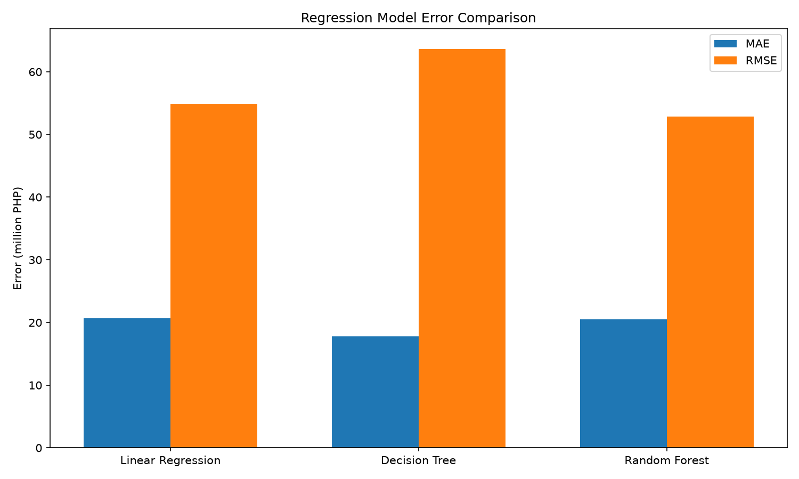


# CMSC 170 — Final Project

University of the Philippines Los Baños  

CMSC 170: Introduction to Artificial Intelligence

## Project Overview

This project aims to implement and compare three machine learning regression methods from scratch using the DPWH Infrastructure Transparency Dataset.

The proposed task is to predict infrastructure project budgets based on available project characteristics.

## Dataset

- **Name:** DPWH Infrastructure Transparency Dataset
- **Source:** https://data.bettergov.ph/
- **Records:** 248,220
- **Fields:** 23
- **Original Format:** Parquet
- **Working Format:** CSV (converted from Parquet)

### Proposed Features

- Project category
- Infrastructure year
- Region

**Target variable:** Project budget (PHP)

Feature selection and preprocessing procedures will be finalized during development.

## Methods

The following regression methods will be implemented and compared:

1. **Linear Regression** — Predicts budgets using learned numerical relationships between project characteristics.
2. **Decision Tree Regression** — Predicts budgets using learned decision rules.
3. **Random Forest Regression** — Combines predictions from multiple decision trees.

All methods will use a common dataset preparation and evaluation setup to ensure a fair comparison.

## Project Structure

The following is our **target project structure**. Some files and directories have not been created yet and will be added as development progresses.

```text
cmsc-170-ai-project/
├── data/
│   ├── README.md
│   └── DATA_PLAN.md
│
├── src/
│   ├── models/
│   │   ├── linear_regression.py
│   │   ├── decision_tree.py
│   │   └── random_forest.py
│   │
│   ├── data_loader.py
│   ├── preprocessing.py
│   └── evaluation.py
│
├── results/
│
├── docs/
│   └── index.html
│
├── README.md
├── CONTRIBUTIONS.md
└── .gitignore
```

### Directory Descriptions

| Path | Purpose |
|---|---|
| `data/` | Dataset documentation, sources, and data preparation plan |
| `src/models/` | From-scratch implementations of the three regression methods |
| `src/data_loader.py` | Loading and reading dataset records |
| `src/preprocessing.py` | Data cleaning, feature encoding, and dataset splitting |
| `src/evaluation.py` | Evaluation metrics and model comparison |
| `results/` | Experimental results, comparison tables, and visualizations |
| `docs/` | GitHub Pages project website |
| `CONTRIBUTIONS.md` | Group responsibilities and contribution log |
| `.gitignore` | Excludes local datasets and unnecessary files from Git tracking |

**Note:** Dataset files are excluded from Git tracking. The original dataset can be obtained from the source linked above. Empty directories may not appear on GitHub until files are added.

## Implementation Guidelines

All machine learning methods will be implemented from scratch by the group.

Permitted tools include:

- Python standard library
- NumPy (arrays and basic linear algebra only)
- Matplotlib (plots and visualizations)

Libraries that provide prebuilt machine learning algorithms, such as scikit-learn, TensorFlow, and PyTorch, will not be used.

All group members are responsible for understanding their implementations and contributing to the project's development.

## Development Workflow

The project follows a collaborative Git workflow:

1. The `main` branch contains the integrated project.
2. Members work on separate feature branches for their assigned tasks.
3. Changes are reviewed and integrated through pull requests.
4. All implementations follow the agreed data format and experimental setup.
5. Contributions and milestone progress are documented throughout development.

### Initial Responsibilities

| Member | Primary Responsibility |
|---|---|
| Group Leader | Repository management, data preparation, Linear Regression, and integration |
| Member 2 | Decision Tree Regression |
| Member 3 | Random Forest Regression |

Assignments may be adjusted based on group discussion and development requirements.

All members will contribute to testing, evaluation, documentation, and the final presentation.

## Project Milestones

| Milestone | Schedule | Deliverable |
|---|---|---|
| 1 — Proposal | October 19–23, 2026 | Dataset and methods approval |
| 2 — Working Program | November 2–6, 2026 | Working implementations of all methods |
| 3 — Comparison | November 9–13, 2026 | Evaluation workflow and comparison results |
| 4 — Project Page | November 16–20, 2026 | GitHub Pages project website |
| 5 — Presentation | November 23–27, 2026 | Final group presentation |


## Reproducibility

### Requirements

- Python 3.12
- NumPy
- Matplotlib

Install the required libraries:

```powershell
python -m pip install numpy matplotlib
```

The regression algorithms were implemented from scratch. NumPy is used for numerical operations, while Matplotlib is used to generate graphs.

### Dataset Setup

The project uses the DPWH Infrastructure Transparency Dataset.

The original dataset is available at:
https://huggingface.co/datasets/bettergovph/dpwh-transparency-data

The program expects the prepared CSV file at:

`data/dpwh_transparency_data.csv`

The CSV must contain the original fields used during preprocessing, including `category`, `infraYear`, `location`, and `budget`.

The dataset is excluded from Git because of its file size. See `data/README.md` for additional dataset information.

### Data Preparation

All three models use the same preprocessing procedure:

1. Remove projects with zero budgets or missing required values.
2. Extract the region from each project's location information.
3. Use project category, infrastructure year, and region as input features.
4. Group categories outside the five most common training categories into an "Other" category.
5. Encode categorical features and scale the infrastructure year.
6. Split the prepared dataset into 80% training and 20% testing data using a fixed random seed.

The final dataset contains 241,155 valid projects:

- Training projects: 192,924
- Testing projects: 48,231
- Input features: 25

Encoding and scaling information is determined using the training data to avoid data leakage.

### Running the Models

Run the following commands from the repository's root directory.

Linear Regression:

```powershell
python -m src.models.linear_regression
```

Decision Tree Regression:

```powershell
python -m src.models.decision_tree
```

Random Forest Regression:

```powershell
python -m src.models.random_forest
```

To train and compare all three models in one run:

```powershell
python -m src.comparison
```

### Model Settings

| Model | Settings |
|---|---|
| Linear Regression | Learning rate: 0.05; iterations: 200 |
| Decision Tree | Maximum depth: 16; minimum split: 20; minimum leaf: 10 |
| Random Forest | 5 trees; maximum depth: 8; minimum split: 20; minimum leaf: 10; 5 features per split; random state: 42 |

Linear Regression trains using budgets expressed in millions of PHP, then converts predictions back to PHP before evaluation.

The other two models use budgets in PHP directly.

### Evaluation Results

All three models were evaluated using the same 48,231 testing projects.

| Metric | Linear Regression | Decision Tree | Random Forest |
|---|---:|---:|---:|
| MAE (PHP) | 22,711,846.66 | **21,145,852.77** | 21,951,105.32 |
| MSE (PHP²) | 3.203e+15 | 3.283e+15 | **3.021e+15** |
| RMSE (PHP) | 56,596,485.12 | 57,299,852.40 | **54,964,604.78** |
| R² | 0.0725 | 0.0493 | **0.1252** |

The median training-budget baseline achieved an MAE of PHP 22,067,800.77.

Decision Tree produced the lowest MAE, while Random Forest achieved the lowest MSE and RMSE and the highest R².

However, all three models have relatively low R² values. This suggests that the selected project characteristics explain only a limited portion of the variation in infrastructure budgets.

### Generated Results

Running the unified comparison creates the following files:

- `results/model_comparison.csv` - Numerical evaluation results
- `results/error_comparison.png` - MAE and RMSE comparison
- `results/r2_comparison.png` - R² comparison

#### Error Comparison



#### R-squared Comparison


The graphs and CSV are also included in the repository for reference.

## References and AI Assistance

- DPWH Infrastructure Transparency Dataset — https://data.bettergov.ph/
- CMSC 170 Final Project Guidelines

ChatGPT has been used to assist with initial dataset exploration, project planning, repository organization, and documentation.

All machine learning implementations will be written and reviewed by the group. Additional AI assistance, if any, will be documented in the final project page.